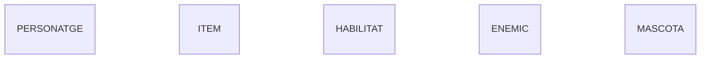
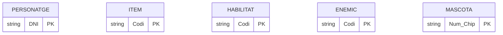
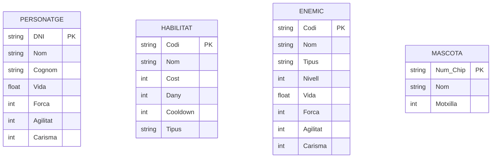
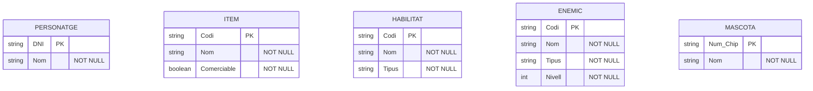
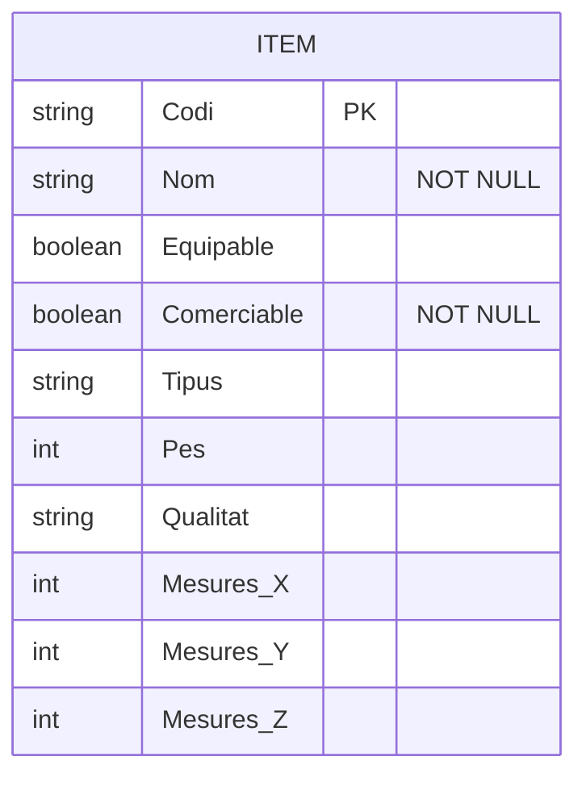
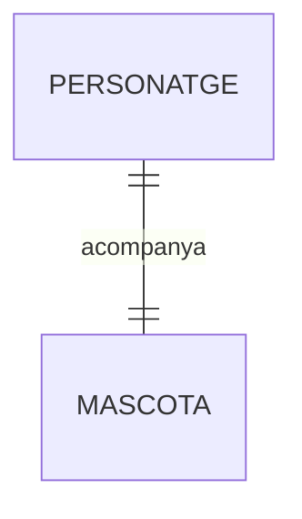
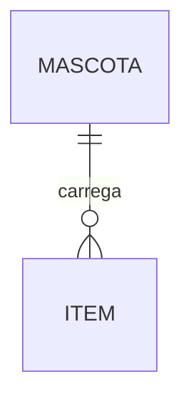
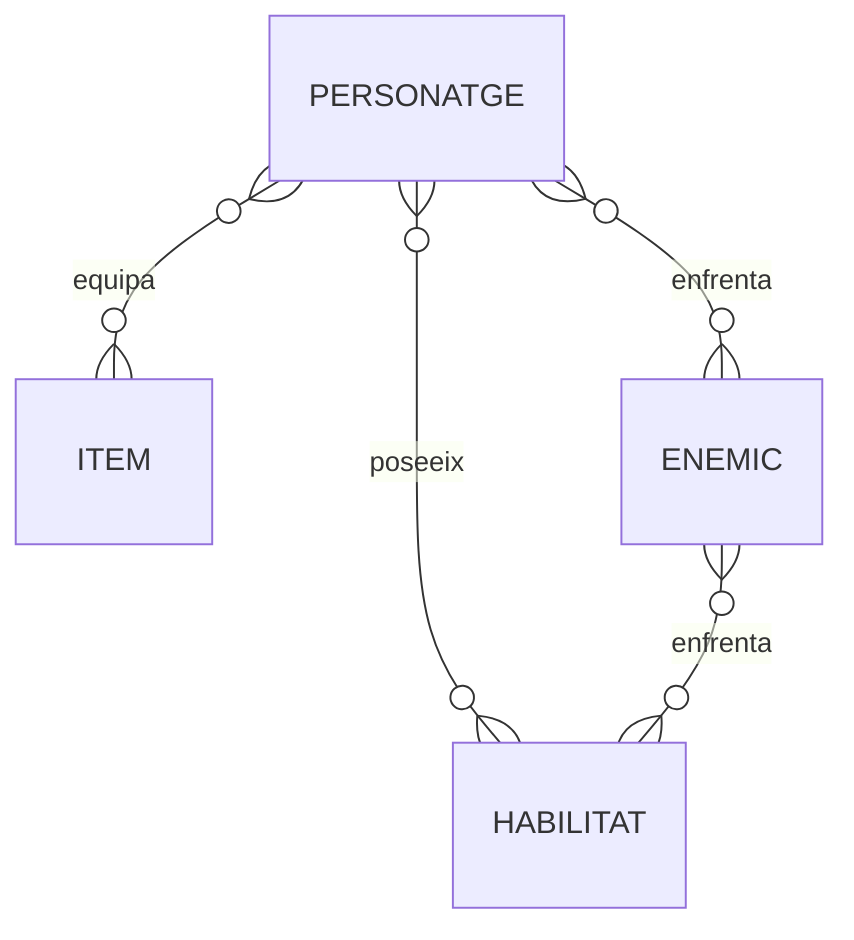
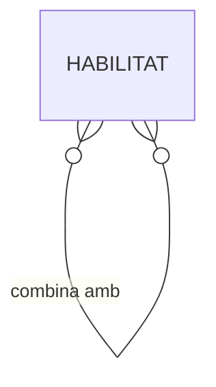
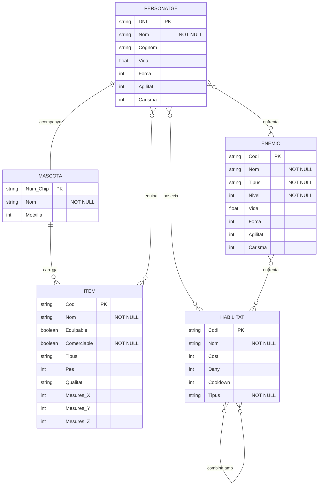

# Activitat 02 - Diagrama E/R en Mermaid

Diagrama E/R fet amb Markdown + Mermaid a partir del model conceptual del PDF, seguint la guia del professor.

## Entitats

Una entitat és un objecte sobre el qual volem guardar informació. Al model conceptual n'hi ha cinc: Personatge, Item, Habilitat, Enemic i Mascota.

> Representació en Mermaid: he posat `erDiagram` a dalt perquè Mermaid sàpiga que és un diagrama E/R, i després el nom de cada entitat en majúscules, una per línia.

## Atributs

Els atributs són les característiques de cada entitat.

> Representació en Mermaid: he obert unes claus `{}` després del nom de cada entitat i hi he posat els atributs a dins, un per línia.

### Tipus d'Atributs

#### Atribut Identificador (Clau Primària)

És l'atribut que identifica cada element de l'entitat i que no es pot repetir. Al model conceptual són els que estan subratllats.

> Representació en Mermaid: he afegit `PK` al final de l'atribut.

> Exemple: he posat `string` al DNI del Personatge perquè té números i una lletra. Al Codi d'Item, Habilitat i Enemic i al Num_Chip de Mascota també he posat `string`, perquè són identificadors i no cal fer operacions amb ells.

### Atributs Simples

Són els atributs que no es poden dividir en parts més petites.

> Representació en Mermaid: he escrit primer el tipus de dada i després el nom de l'atribut.

> Exemple: he posat `string` a Nom, Cognom i Tipus perquè són text. He posat `int` a Forca, Agilitat, Carisma, Cost, Dany, Cooldown, Nivell i Motxilla perquè són números sencers. He posat `float` a Vida perquè la vida pot tenir decimals.

### Atributs no nuls

Són els atributs que sempre han de tenir valor. Al model conceptual són els que tenen un cercle groc.

> Representació en Mermaid: he afegit `"NOT NULL"` al final de l'atribut.

> Exemple: he posat `"NOT NULL"` al Nom de Personatge, Item, Habilitat, Enemic i Mascota perquè tots han de tenir nom. Al Tipus d'Habilitat i d'Enemic, al Nivell d'Enemic i al Comerciable d'Item també, perquè al model conceptual tenen el cercle. A les claus primàries no l'he posat perquè ja són obligatòries per ser PK.

### Atributs Compostos

Són els atributs que es poden dividir en parts més petites amb significat propi.

> Representació en Mermaid: Mermaid no té sintaxi per als atributs compostos, així que he posat els components directament com a atributs simples.

> Exemple: l'atribut Mesures d'Item es divideix en X, Y i Z, així que he posat tres atributs: `Mesures_X`, `Mesures_Y` i `Mesures_Z`, tots `int` perquè són mesures amb números sencers. A Equipable i Comerciable he posat `boolean` perquè només tenen dos valors possibles: sí o no. A Pes he posat `int` perquè és un número, i a Qualitat i Tipus `string` perquè són text.

## Relacions

Una relació és un vincle entre dues entitats.

> Representació en Mermaid: he dibuixat una línia entre les dues entitats i he posat el nom de la relació després dels dos punts.

### Cardinalitat de la Relació

La cardinalitat s'indica amb uns símbols a cada extrem de la línia. Els que he fet servir són:

    || : Exactament un

    }o : Molts o zero

    o{ : Zero o molts

#### Un a Un (1:1)

> Exemple: a la relació Acompanya he posat `||` als dos costats perquè al model conceptual hi ha un 1 al costat de Personatge i un 1 al costat de Mascota. Vol dir que un personatge només té una mascota, i que una mascota només acompanya un personatge. He posat el verb `acompanya` com a nom de la relació perquè és el que surt al model.

#### Un a Molts (1:N)

> Exemple: a la relació Carrega he posat `||` al costat de Mascota i `o{` al costat d'Item. Al model conceptual aquesta relació no té cap número, així que ho he decidit jo: una mascota té motxilla i pot carregar molts ítems, però un ítem només el pot carregar una mascota. He posat `o{` i no `|{` perquè una mascota pot no carregar cap ítem.

#### Molts a Molts (M:N)

> Exemple: a Poseeix he posat `}o--o{` perquè al model conceptual hi ha una M al costat de Personatge i una N al costat d'Habilitat. Un personatge pot tenir moltes habilitats, i una mateixa habilitat la poden tenir molts personatges.
>
> A Equipa he posat `}o--o{` perquè hi ha una M al costat de Personatge i una N al costat d'Item. Un personatge pot equipar molts ítems, i un mateix ítem el poden equipar molts personatges.
>
> A la primera Enfrenta (entre Personatge i Enemic) he posat `}o--o{` perquè hi ha una M al costat de Personatge i una N al costat d'Enemic. Un personatge s'enfronta a molts enemics, i un enemic es pot enfrontar a molts personatges.
>
> A la segona Enfrenta (entre Enemic i Habilitat) he posat `}o--o{` perquè hi ha una N al costat d'Enemic i una M al costat d'Habilitat. Un enemic s'enfronta a moltes habilitats, i una habilitat es pot enfrontar a molts enemics. Aquesta relació té el mateix nom que l'altra, però uneix entitats diferents.

#### Relacions Reflexives

Passen quan una entitat es relaciona amb ella mateixa.

> Exemple: la relació Combina amb va d'Habilitat a Habilitat, perquè una habilitat es pot combinar amb altres habilitats. He posat `}o--o{` perquè al model conceptual té una M i una N, o sigui que és de molts a molts. He posat el nom entre cometes (`"combina amb"`) perquè té un espai.

## Diagrama E/R complet

Aquí hi ha el diagrama sencer, amb totes les entitats, els atributs i les relacions.

