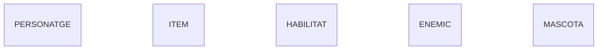
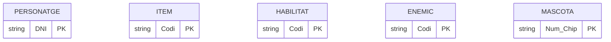

# Activitat 02 - Diagrama E/R en Mermaid

Diagrama E/R fet amb Markdown + Mermaid a partir del model conceptual del PDF, seguint la guia del professor.

## Entitats

Una entitat és un objecte sobre el qual volem guardar informació. Al model conceptual n'hi ha cinc: Personatge, Item, Habilitat, Enemic i Mascota.

> Representació en Mermaid: he posat `erDiagram` a dalt perquè Mermaid sàpiga que és un diagrama E/R, i després el nom de cada entitat en majúscules, una per línia.

## Atributs

Els atributs són les característiques de cada entitat.

> Representació en Mermaid: he obert unes claus `{}` després del nom de cada entitat i hi he posat els atributs a dins, un per línia.

### Tipus d'Atributs

#### Atribut Identificador (Clau Primària)

És l'atribut que identifica cada element de l'entitat i que no es pot repetir. Al model conceptual són els que estan subratllats.

> Representació en Mermaid: he afegit `PK` al final de l'atribut.

> Exemple: he posat `string` al DNI del Personatge perquè té números i una lletra. Al Codi d'Item, Habilitat i Enemic i al Num_Chip de Mascota també he posat `string`, perquè són identificadors i no cal fer operacions amb ells.

