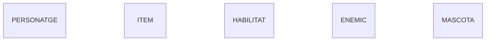

# Activitat 02 - Diagrama E/R en Mermaid

Diagrama E/R fet amb Markdown + Mermaid a partir del model conceptual del PDF, seguint la guia del professor.

## Entitats

Una entitat és un objecte sobre el qual volem guardar informació. Al model conceptual n'hi ha cinc: Personatge, Item, Habilitat, Enemic i Mascota.

> Representació en Mermaid: he posat `erDiagram` a dalt perquè Mermaid sàpiga que és un diagrama E/R, i després el nom de cada entitat en majúscules, una per línia.

