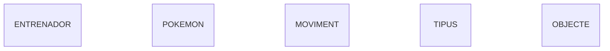
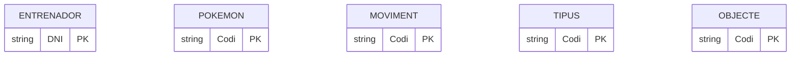
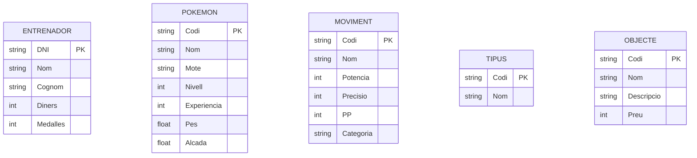
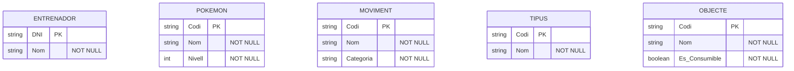
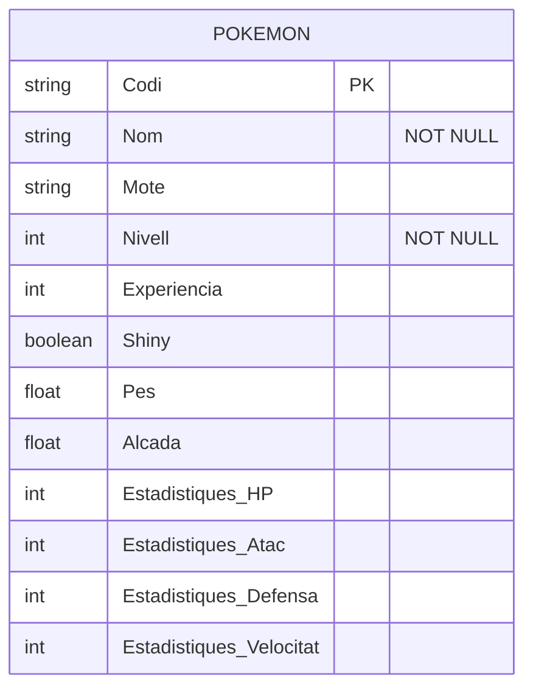
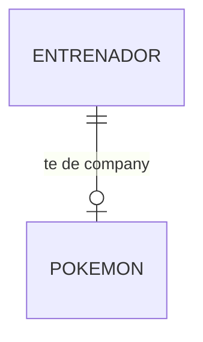
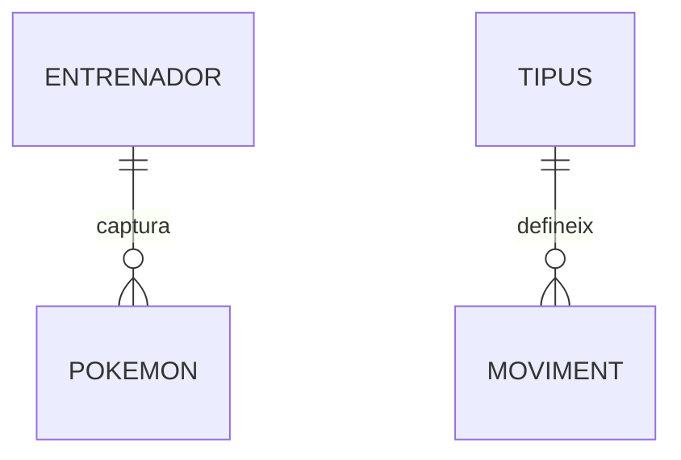
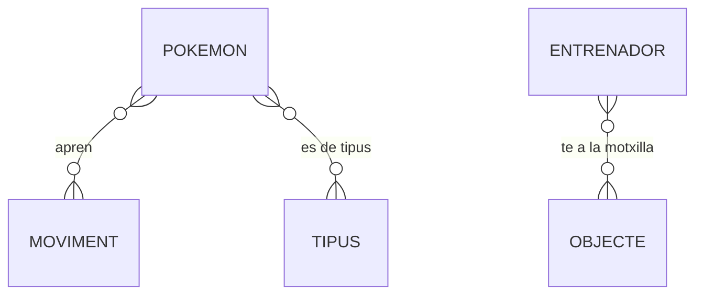
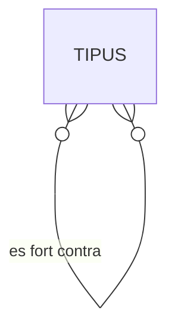
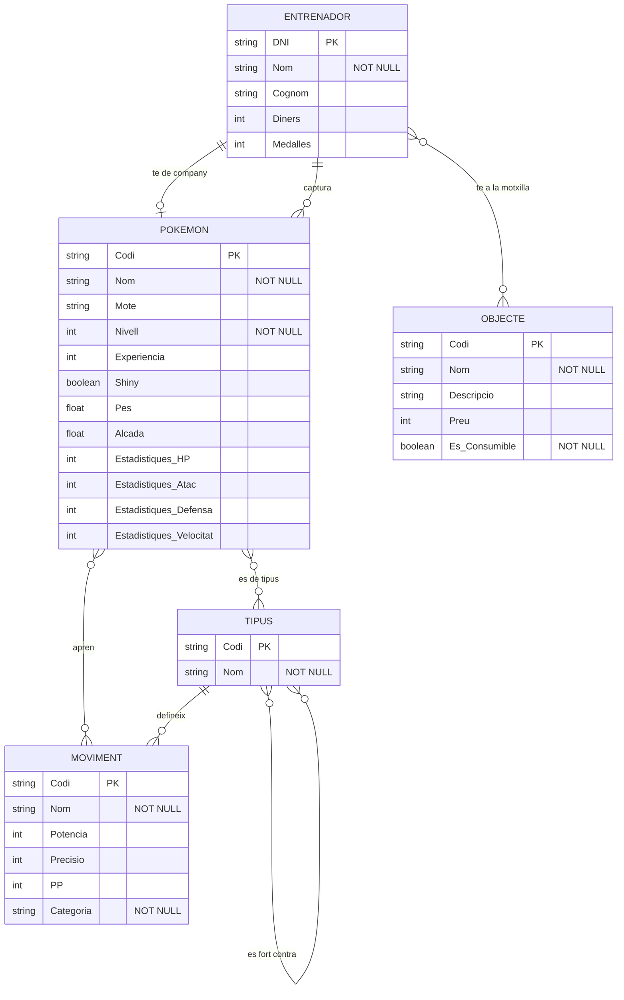

# Activitat 02 - Diagrama E/R en Mermaid (Pokémon)

Diagrama E/R fet amb Markdown + Mermaid a partir del model conceptual del PDF, seguint la guia del professor. El tema que he triat és el món Pokémon.

## Entitats

Una entitat és un objecte sobre el qual volem guardar informació. En aquest model n'hi ha cinc: Entrenador, Pokemon, Moviment, Tipus i Objecte.

> Representació en Mermaid: he posat `erDiagram` a dalt perquè Mermaid sàpiga que és un diagrama E/R, i després el nom de cada entitat en majúscules, una per línia. He escrit els noms sense accents perquè Mermaid dona problemes amb ells.

## Atributs

Els atributs són les característiques de cada entitat.

> Representació en Mermaid: he obert unes claus `{}` després del nom de cada entitat i hi he posat els atributs a dins, un per línia.

### Tipus d'Atributs

#### Atribut Identificador (Clau Primària)

És l'atribut que identifica cada element de l'entitat i que no es pot repetir. Al model conceptual són els que estan subratllats.

> Representació en Mermaid: he afegit `PK` al final de l'atribut.

> Exemple: he posat `string` al DNI de l'Entrenador perquè té números i una lletra. Al Codi de Pokemon, Moviment, Tipus i Objecte també he posat `string`, perquè són identificadors i no cal fer operacions amb ells.

### Atributs Simples

Són els atributs que no es poden dividir en parts més petites.

> Representació en Mermaid: he escrit primer el tipus de dada i després el nom de l'atribut.

> Exemple: he posat `string` a Nom, Cognom, Mote, Categoria i Descripcio perquè són text. He posat `int` a Nivell, Experiencia, Potencia, Precisio, PP, Preu, Diners i Medalles perquè són números sencers. He posat `float` a Pes i Alcada perquè poden tenir decimals (per exemple 6,9 kg).

### Atributs no nuls

Són els atributs que sempre han de tenir valor. Al model conceptual són els que tenen un cercle groc.

> Representació en Mermaid: he afegit `"NOT NULL"` al final de l'atribut.

> Exemple: he posat `"NOT NULL"` al Nom d'Entrenador, Pokemon, Moviment, Tipus i Objecte perquè tots han de tenir nom. Al Nivell de Pokemon, a la Categoria de Moviment i a Es_Consumible d'Objecte també, perquè sempre han de tenir valor. A les claus primàries no l'he posat perquè ja són obligatòries per ser PK.

### Atributs Compostos

Són els atributs que es poden dividir en parts més petites amb significat propi.

> Representació en Mermaid: Mermaid no té sintaxi per als atributs compostos, així que he posat els components directament com a atributs simples.

> Exemple: l'atribut Estadistiques de Pokemon es divideix en HP, Atac, Defensa i Velocitat, així que he posat quatre atributs: `Estadistiques_HP`, `Estadistiques_Atac`, `Estadistiques_Defensa` i `Estadistiques_Velocitat`, tots `int` perquè són números sencers. A Shiny he posat `boolean` perquè només té dos valors possibles: sí o no.

## Relacions

Una relació és un vincle entre dues entitats.

> Representació en Mermaid: he dibuixat una línia entre les dues entitats i he posat el nom de la relació després dels dos punts.

### Cardinalitat de la Relació

La cardinalitat s'indica amb uns símbols a cada extrem de la línia. Els que he fet servir són:

    || : Exactament un

    o| : Zero o un

    }o : Molts o zero

    o{ : Zero o molts

#### Un a Un (1:1)

> Exemple: a la relació Te de company he posat `||` al costat d'Entrenador i `o|` al costat de Pokemon. Vol dir que un entrenador té exactament un Pokémon company, però un Pokémon pot no ser el company de cap entrenador. He posat `o|` i no `||` perquè la majoria de Pokémon no són el company de ningú. Aquesta cardinalitat l'he decidit jo.

#### Un a Molts (1:N)

> Exemple: a la relació Captura he posat `||` al costat d'Entrenador i `o{` al costat de Pokemon. Un entrenador pot capturar molts Pokémon, però cada Pokémon només pertany a un entrenador. He posat `o{` i no `|{` perquè un entrenador pot no haver capturat cap Pokémon encara.
>
> A la relació Defineix he posat `||` al costat de Tipus i `o{` al costat de Moviment. Cada moviment és d'un sol tipus (per exemple, Llançaflames és de tipus Foc), però un tipus pot tenir molts moviments.

#### Molts a Molts (M:N)

> Exemple: a Apren he posat `}o--o{` perquè un Pokémon pot aprendre molts moviments, i un mateix moviment el poden aprendre molts Pokémon.
>
> A Es de tipus (entre Pokemon i Tipus) he posat `}o--o{` perquè un Pokémon pot tenir un o dos tipus (per exemple Foc i Volador), i un tipus el tenen molts Pokémon.
>
> A Te a la motxilla he posat `}o--o{` perquè un entrenador pot tenir molts objectes diferents, i un mateix objecte (com una Poció) el poden tenir molts entrenadors.

#### Relacions Reflexives

Passen quan una entitat es relaciona amb ella mateixa.

> Exemple: la relació Es fort contra va de Tipus a Tipus, perquè un tipus és fort contra altres tipus (Aigua és fort contra Foc) i alhora altres tipus són forts contra ell. He posat `}o--o{` perquè és de molts a molts. He posat el nom entre cometes (`"es fort contra"`) perquè té espais.

## Diagrama E/R complet

Aquí hi ha el diagrama sencer, amb totes les entitats, els atributs i les relacions.

